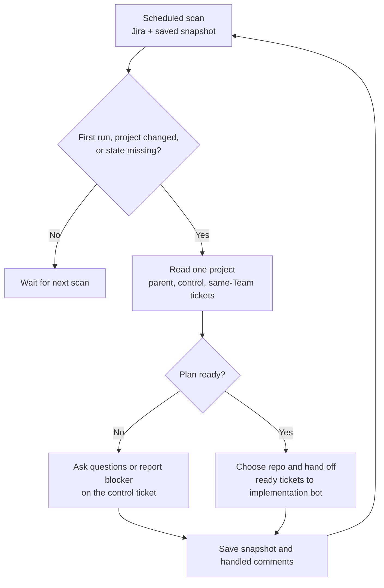

# fabric-access-ai-dev

Custom bot runner instance for the Fabric Access team, built on [dev-bot](https://github.com/RedHatInsights/platform-frontend-ai-dev).

Focused on [insights-rbac](https://github.com/RedHatInsights/insights-rbac) — a Django REST Framework microservice providing Role-Based Access Control for console.redhat.com.

## Architecture

Uses dev-bot as a git submodule. The submodule ships `Dockerfile.runner` which builds the full bot image and runs instance-specific customization hooks from this repo.

```
fabric-access-ai-dev/
├── dev-bot/        # Git submodule (don't modify)
├── setup.sh        # Custom build steps (dnf install, pip install, etc.)
├── instance/       # Extra files COPYed into the image
│   ├── rbac-config/              # Jira-sprint instance
│   │   └── agent/
│   │       ├── instance.yaml        # workflow: jira-sprint
│   │       ├── project-repos.json
│   │       ├── mcp.json
│   │       └── personas/
│   ├── rbac-config-konflux/      # Konflux PR-squash instance
│   ├── rbac-project-coordinator/ # Jira parent/control-ticket coordinator
│   ├── rbac-config-pr-label/     # GitHub PR-label instance (label: dev-bot)
│   │   └── agent/
│   │       ├── instance.yaml        # workflow: ./workflows/pr-label
│   │       ├── project-repos.json
│   │       └── workflows/pr-label/
│   └── rbac-config-review/       # GitHub review-only instance (label: dev-bot-review)
│       └── agent/
│           ├── instance.yaml        # workflow: ./workflows/review-only
│           ├── project-repos.json   # PR review allowlist
│           ├── review-context.yaml  # related repos and direct Markdown links
│           └── workflows/review-only/
└── README.md
```

One instance = one workflow. `rbac-config` still starts from Jira. `rbac-config-pr-label` watches open GitHub PRs labeled `dev-bot`, creates a memory-server task, and pushes commits / review suggestions onto that same PR. It requires a bracketed Jira key in each PR title, creates and links a Jira Task when a labeled PR has no key, and updates that Jira issue to **Release Pending** when the PR merges.

To run the PR-label instance, deploy a **second** bot with the same image. Do not copy the Jira bot's `BOT_LABEL` or `BOT_INSTANCE_ID`.

| Parameter | Required | Example |
|-----------|----------|---------|
| `BOT_CONFIG_PATH` | yes | `instance/rbac-config-pr-label` |
| `BOT_NAME` | yes | a name distinct from the Jira bot (e.g. `devbot-fabric-access-pr-label`) |
| `BOT_INSTANCE_ID` | yes, **must differ** from the Jira and Konflux bots | e.g. `fabric-access-pr-label` |
| `BOT_PR_LABEL` | no (defaults to `dev-bot`) | GitHub PR label to watch |
| `BOT_LABEL` | ignored by this workflow | leave as-is; it is the Jira ticket label |

The GitHub label is `BOT_PR_LABEL`, not `BOT_LABEL`, so a copied Jira deploy target cannot accidentally search for the Jira label on GitHub.

### Review-only instance

`rbac-config-review` scans the GitHub repositories in its `project-repos.json`
for open PRs carrying the label configured by `review-context.yaml` (currently
`dev-bot-review`). It reviews at most one PR per cycle and publishes a GitHub
summary with inline comments for verified findings. The workflow is read-only
for source code. Its settings, review-context and dimensions YAML, selection
rules, and review stages are documented in the
[review bot README](instance/rbac-config-review/README.md).

The GitHub PR label is `review-context.yaml: review_label`; deployment
`BOT_LABEL` identifies the runner and does not control PR selection. The review
instance configuration lives under `instance/rbac-config-review` and is
deployed separately from the Jira and PR-label instances. This profile handles
GitHub PRs; the `app-interface` GitLab repository needs an MR adapter before it
can enter this queue.

No Dockerfile in this repo — Konflux points at `dev-bot/Dockerfile.runner`.

## Jira project coordinator

`instance/rbac-project-coordinator` is a separate bot instance using the
`project-coordinator` workflow. It discovers RHCLOUD control tickets labeled
`dev-bot-control`, checks the parent and direct children against a configured
Jira Team ID, and posts project plans and progress on the control ticket. It
never writes code. Implementation stays with the `rbac-config` Jira bot.

Deploy another bot target using `deploy/template.yaml` or
`deploy/rbac-config-template.yaml`, with a distinct `BOT_NAME` and
`BOT_INSTANCE_ID`. Set these parameters for the coordinator target:

| Parameter | Value |
|---|---|
| `BOT_CONFIG_PATH` | `instance/rbac-project-coordinator` |
| `BOT_LABEL` | `dev-bot-control` |
| `BOT_IMPLEMENTATION_LABEL` | The implementation bot's actual Jira label, currently `hcc-ai-platform-accessmanagement` |
| `BOT_JIRA_PROJECT` | `RHCLOUD` |
| `BOT_TEAM_FIELD_ID` | Jira's Team custom field key: `customfield_10001` (also used by this instance's review profiles) |
| `BOT_INCLUDE_BACKLOG` | Match the implementation bot's backlog setting; if `false`, runnable tickets need an active sprint |
| `BOT_EXECUTION_ENGINE` | `coordinator` (the runner uses OpenCode for this workflow) |
| `REHOR_OPENCODE_DEPLOYMENT_CONFIG` | `/home/botuser/app/instance/rbac-project-coordinator/opencode-deployment.json` |

No parent or control ticket key is hardcoded. Prepare Jira before the first
coordinator run:

1. **Configure the bot.** Set the Jira Team field ID, implementation label,
   and repository allowlist. The coordinator reads the Team option ID from each
   control ticket; it does not need a fixed Team ID in deployment config. Each
   `repo:<name>` allowed on the control ticket must match a key in
   `project-repos.json`.
2. **Prepare the parent and control ticket.** Use an Epic or supported parent
   issue with a clear project goal. Create exactly one direct child control
   ticket for this Team, set its Jira Team field, and add the `dev-bot-control`
   label. The coordinator reads the Team ID from this field and uses it to
   scope the project. Add the permitted `repo:<name>` labels to this
   control ticket. Leave phase and implementation labels off it. The
   coordinator sets its first state label when it enrolls the project.
3. **Prepare implementation tickets.** Make each in-scope ticket a direct
   child of the same parent with the same Team ID. Give each a clear outcome
   and acceptance criteria. Every same-Team direct child other than the
   control ticket is treated as project work, so keep unrelated tickets out
   of this parent or include them in the plan.
4. **Mark phases and dependencies.** Put exactly one `phase:NN` label on each
   implementation ticket, including later-phase tickets. At least one ticket
   must have `phase:01`. The planner will suggest a phase for each ticket and
   show dependencies and parallel groups in its control-ticket comment; the
   user applies the phase labels. Link each root ticket (no same-Team
   predecessor) with `relates to` the control ticket. To ask the coordinator
   to add an ordering link, comment
   `/coord dependency RHCLOUD-123 blocks RHCLOUD-456` on the control ticket.
   The coordinator checks that both tickets are same-Team children and that
   the link will not create a cycle.
5. **Make first handoffs possible.** Tickets ready for handoff must be
   unassigned and in `New`, `Backlog`, `Refinement`, or `To Do`. They need an
   active sprint unless `BOT_INCLUDE_BACKLOG` is enabled. The coordinator
   chooses each ticket's repo from the control ticket's allowlist; make the
   ticket scope clear enough to identify the right repo.

On first enrollment, the coordinator reports missing setup on the control
ticket and normally sets `dev-bot-coordinator:needs-plan`. If the plan already
passes the readiness gate, it can proceed to `dev-bot-coordinator:active`.
The control ticket has one coordinator state label:
`dev-bot-coordinator:needs-plan`, `dev-bot-coordinator:active`,
`dev-bot-coordinator:blocked`, or `dev-bot-coordinator:complete`.

The coordinator proposes missing tickets, edits, and closures; it creates a
ticket only when a later comment says `/coord create P-1` for a named proposal.
`/coord status` requests a fresh summary; `/coord complete project` can finish
the project after all same-Team implementation tickets are complete. It never
edits or closes implementation tickets.

The preflight is read-only. It starts a coordinator session on first enrollment,
when project data or user comments change, or when a coordinator state label is
missing. Otherwise, it skips the project. The workflow's `actions.py`
revalidates Jira state before state, handoff, comment, or ticket-creation
writes. New deployment parameters must be supplied by the deployment target;
this repository does not deploy the coordinator by itself.

### Coordination cycle



| Step | Inputs | What happens |
|---|---|---|
| 1. Scan | Project, control label, Team field key, repo allowlist, backlog setting, and saved memory snapshot. | Finds control tickets and their parent issues. Reads each control ticket's Team ID and includes only direct children with that same ID. |
| 2. Detect change | Parent and control details; same-Team child status, labels, links, ownership, sprint, and human control comments. | Skips unchanged projects. Starts a cycle for a first run, changed project, or missing state label. |
| 3. Review | Changed project payload: ticket keys, phases, statuses, dependencies, gaps, ready/waiting tickets, allowed repos, and new comments. | Coordinator rereads relevant Jira tickets and checks whether the plan is clear. |
| 4. Decide | Phase labels, root-ticket `relates to` links, `blocks` dependencies, acceptance criteria, repo choices, and implementation readiness. | If details are missing, asks on the control ticket. Otherwise identifies unblocked tickets in the lowest incomplete phase. |
| 5. Act and save | User request, when present; selected ticket and repo; latest Jira state. | Validated actions update the control ticket or hand off ready work. Saves the snapshot and handled comment IDs for the next scan. |

On the control ticket, users can request:

```text
/coord status
/coord dependency RHCLOUD-123 blocks RHCLOUD-456
/coord create P-1
/coord complete project
```

`/coord create P-1` applies only to a previously proposed ticket;
`/coord complete project` requires all in-scope tickets to be complete.
During planning, the control comment lists every in-scope ticket with its
current status and phase, plus suggested phases, dependencies, parallel
groups, and repo routing. Dependency changes are applied only when the user
requests the exact `blocks` direction in Jira; suggested phases remain
suggestions. Jira remains the source of truth; the coordinator rereads
relevant issues before acting. The shared Jira MCP service must expose
`jira_create_issue_link` for requested dependencies.

## Build

```bash
git submodule update --init --recursive
docker build -f dev-bot/Dockerfile.runner -t fabric-access-ai-dev:local .
```

Or use the helper script:

```bash
./build.sh
```

## Customization

- **setup.sh** — runs as root during build. Install packages, write config, etc.
- **instance/** — files COPYed to `/home/botuser/app/instance/` in the image.

## Updating dev-bot

```bash
cd dev-bot && git pull origin master && cd ..
git add dev-bot
git commit -m "chore: update dev-bot submodule"
```

Konflux also opens automated PRs when dev-bot merges new features.

## Konflux

```yaml
dockerfile: dev-bot/Dockerfile.runner
path-context: .
```
