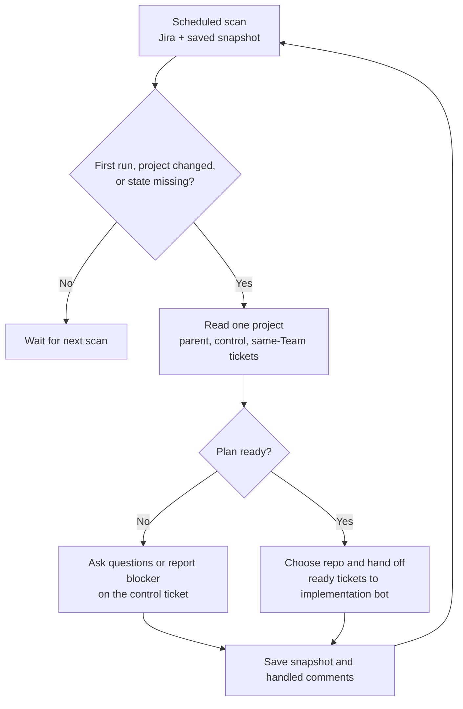

# fabric-access-ai-dev

Custom bot runner instance for the Fabric Access team, built on [dev-bot](https://github.com/RedHatInsights/platform-frontend-ai-dev).

Focused on [insights-rbac](https://github.com/RedHatInsights/insights-rbac) — a Django REST Framework microservice providing Role-Based Access Control for console.redhat.com.

## Architecture

Uses dev-bot as a git submodule. The submodule ships `Dockerfile.runner` which builds the full bot image and runs instance-specific customization hooks from this repo.

```
fabric-access-ai-dev/
├── dev-bot/        # Git submodule (don't modify)
├── setup.sh        # Custom build steps (dnf install, pip install, etc.)
├── instance/       # Extra files COPYed into the image
│   ├── rbac-config/              # Jira-sprint instance
│   │   └── agent/
│   │       ├── instance.yaml        # workflow: jira-sprint
│   │       ├── project-repos.json
│   │       ├── mcp.json
│   │       └── personas/
│   ├── rbac-config-konflux/      # Konflux PR-squash instance
│   ├── rbac-project-coordinator/ # Jira parent/control-ticket coordinator
│   ├── rbac-config-pr-label/     # GitHub PR-label instance (label: dev-bot)
│   │   └── agent/
│   │       ├── instance.yaml        # workflow: ./workflows/pr-label
│   │       ├── project-repos.json
│   │       └── workflows/pr-label/
│   └── rbac-config-review/       # GitHub review-only instance (label: dev-bot-review)
│       └── agent/
│           ├── instance.yaml        # workflow: ./workflows/review-only
│           ├── project-repos.json   # PR review allowlist
│           ├── review-context.yaml  # related repos and direct Markdown links
│           └── workflows/review-only/
└── README.md
```

One instance = one workflow. `rbac-config` still starts from Jira. `rbac-config-pr-label` watches open GitHub PRs labeled `dev-bot`, creates a memory-server task, and pushes commits / review suggestions onto that same PR. It requires a bracketed Jira key in each PR title, creates and links a Jira Task when a labeled PR has no key, and updates that Jira issue to **Release Pending** when the PR merges.

To run the PR-label instance, deploy a **second** bot with the same image. Do not copy the Jira bot's `BOT_LABEL` or `BOT_INSTANCE_ID`.

| Parameter | Required | Example |
|-----------|----------|---------|
| `BOT_CONFIG_PATH` | yes | `instance/rbac-config-pr-label` |
| `BOT_NAME` | yes | a name distinct from the Jira bot (e.g. `devbot-fabric-access-pr-label`) |
| `BOT_INSTANCE_ID` | yes, **must differ** from the Jira and Konflux bots | e.g. `fabric-access-pr-label` |
| `BOT_PR_LABEL` | no (defaults to `dev-bot`) | GitHub PR label to watch |
| `BOT_LABEL` | ignored by this workflow | leave as-is; it is the Jira ticket label |

The GitHub label is `BOT_PR_LABEL`, not `BOT_LABEL`, so a copied Jira deploy target cannot accidentally search for the Jira label on GitHub.

### Review-only instance

`rbac-config-review` scans the GitHub repositories in its `project-repos.json`
for open PRs carrying the label configured by `review-context.yaml` (currently
`dev-bot-review`). It reviews at most one PR per cycle and publishes a GitHub
summary with inline comments for verified findings. The workflow is read-only
for source code. Its settings, review-context and dimensions YAML, selection
rules, and review stages are documented in the
[review bot README](instance/rbac-config-review/README.md).

The GitHub PR label is `review-context.yaml: review_label`; deployment
`BOT_LABEL` identifies the runner and does not control PR selection. The review
instance configuration lives under `instance/rbac-config-review` and is
deployed separately from the Jira and PR-label instances. This profile handles
GitHub PRs; the `app-interface` GitLab repository needs an MR adapter before it
can enter this queue.

No Dockerfile in this repo — Konflux points at `dev-bot/Dockerfile.runner`.

## Jira project coordinator

`instance/rbac-project-coordinator` is a separate bot instance using the
`project-coordinator` workflow. It discovers RHCLOUD control tickets labeled
`dev-bot-control`, checks the parent and direct children against a configured
Jira Team ID, and posts project plans and progress on the control ticket. It
never writes code. Implementation stays with the `rbac-config` Jira bot.

Deploy another bot target using `deploy/template.yaml` or
`deploy/rbac-config-template.yaml`, with a distinct `BOT_NAME` and
`BOT_INSTANCE_ID`. Set these parameters for the coordinator target:

| Parameter | Value |
|---|---|
| `BOT_CONFIG_PATH` | `instance/rbac-project-coordinator` |
| `BOT_LABEL` | `dev-bot-control` |
| `BOT_IMPLEMENTATION_LABEL` | The implementation bot's actual Jira label, currently `hcc-ai-platform-accessmanagement` |
| `BOT_JIRA_PROJECT` | `RHCLOUD` |
| `BOT_TEAM_FIELD_ID` | Jira's Team custom field key, e.g. `customfield_12345` (resolve in Jira; example is not a real value) |
| `BOT_TEAM_ID` | The actual Jira Team option ID for the coordinator's Team |
| `BOT_INCLUDE_BACKLOG` | Match the implementation bot's backlog setting; if `false`, runnable tickets need an active sprint |
| `BOT_EXECUTION_ENGINE` | `coordinator` (the runner uses OpenCode for this workflow) |
| `REHOR_OPENCODE_DEPLOYMENT_CONFIG` | `/home/botuser/app/instance/rbac-project-coordinator/opencode-deployment.json` |

No control or parent Jira key is hardcoded. The control label enrolls a child
issue, its parent defines the project, and its Team ID must match
`BOT_TEAM_ID`. `repo:` labels on the control ticket define allowed repos;
`project-repos.json` must contain them. The first phase is supplied by users
with `phase:01` labels on implementation tickets, a `relates to` link from
each ticket without a same-Team predecessor to the control ticket, and
`blocks` links for sequencing. Every same-Team implementation ticket needs
exactly one phase label, including tickets planned for later phases.
The coordinator asks for missing pieces before adding the implementation bot
label. It stores its state on the control ticket as exactly one of
`coord:needs-plan`, `coord:active`, `coord:blocked`, and `coord:complete`.

The coordinator proposes missing tickets, edits, and closures; it creates a
ticket only when a later comment says `/coord create P-1` for a named proposal.
`/coord status` requests a fresh summary; `/coord complete project` can finish
the project after all same-Team implementation tickets are complete. It never
edits or closes implementation tickets.

The preflight is read-only. It starts a coordinator session on first enrollment,
when project data or user comments change, or when a coordinator state label is
missing. Otherwise, it skips the project. The workflow's `actions.py`
revalidates Jira state before state, handoff, comment, or ticket-creation
writes. New deployment parameters must be supplied by the deployment target;
this repository does not deploy the coordinator by itself.

### Coordination cycle



| Step | Inputs | What happens |
|---|---|---|
| 1. Scan | Project, control label, configured Team ID, repo allowlist, backlog setting, and saved memory snapshot. | Finds control tickets and their parent issues. Includes only direct children with the same Team ID. |
| 2. Detect change | Parent and control details; same-Team child status, labels, links, ownership, sprint, and human control comments. | Skips unchanged projects. Starts a cycle for a first run, changed project, or missing state label. |
| 3. Review | Changed project payload: ticket keys, phases, statuses, dependencies, gaps, ready/waiting tickets, allowed repos, and new comments. | Coordinator rereads relevant Jira tickets and checks whether the plan is clear. |
| 4. Decide | Phase labels, root-ticket `relates to` links, `blocks` dependencies, acceptance criteria, repo choices, and implementation readiness. | If details are missing, asks on the control ticket. Otherwise identifies unblocked tickets in the lowest incomplete phase. |
| 5. Act and save | User request, when present; selected ticket and repo; latest Jira state. | Validated actions update the control ticket or hand off ready work. Saves the snapshot and handled comment IDs for the next scan. |

Users can comment `/coord status` for a summary, `/coord create P-1` to create
a previously proposed ticket, or `/coord complete project` to request
completion after all in-scope tickets are done. Jira remains the source of
truth; the coordinator rereads relevant issues before acting.

## Build

```bash
git submodule update --init --recursive
docker build -f dev-bot/Dockerfile.runner -t fabric-access-ai-dev:local .
```

Or use the helper script:

```bash
./build.sh
```

## Customization

- **setup.sh** — runs as root during build. Install packages, write config, etc.
- **instance/** — files COPYed to `/home/botuser/app/instance/` in the image.

## Updating dev-bot

```bash
cd dev-bot && git pull origin master && cd ..
git add dev-bot
git commit -m "chore: update dev-bot submodule"
```

Konflux also opens automated PRs when dev-bot merges new features.

## Konflux

```yaml
dockerfile: dev-bot/Dockerfile.runner
path-context: .
```
