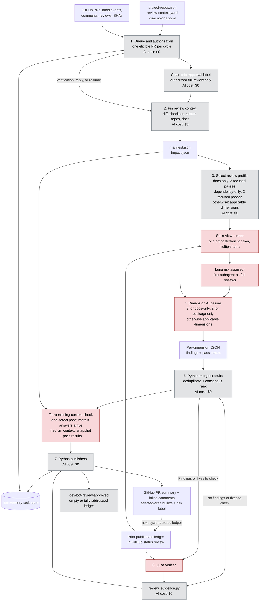
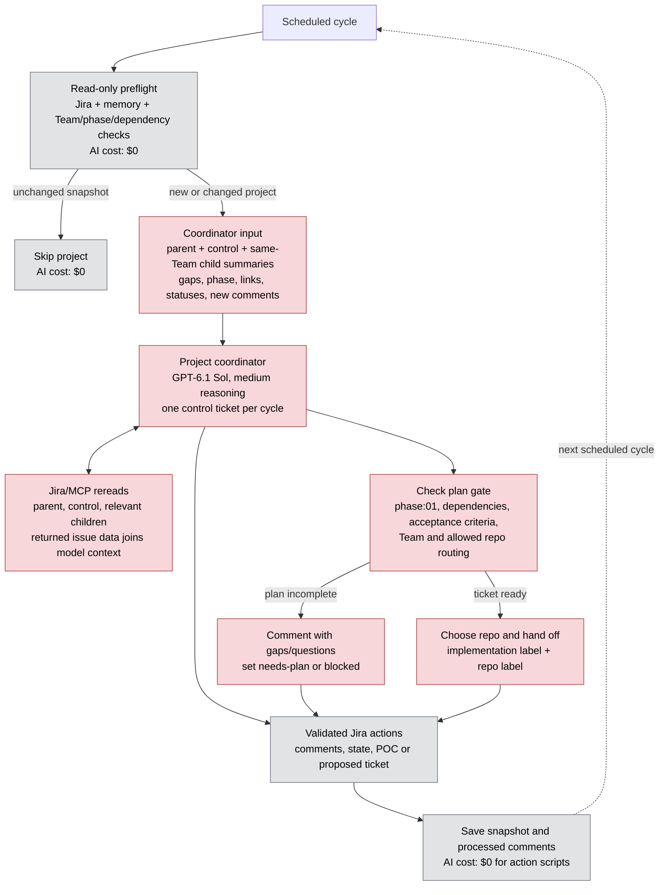

# GitHub PR review bot

This directory configures the `rbac-config-review` instance of the Fabric Access
bot. It reviews open GitHub pull requests and publishes a review summary and
anchored inline comments. The workflow is read-only with respect to source code:
it does not edit files, commit, push, submit a GitHub approval or change request,
or merge PRs. After a full review or verification, it applies the
`dev-bot-review-approved` workflow label only when the verified finding ledger
has no open findings; a new full review clears that label first.

## Configuration files

| File | Purpose |
|---|---|
| [`agent/instance.yaml`](agent/instance.yaml) | Selects the scheduled workflow, runtime, provider, and model. |
| [`opencode-deployment.json`](opencode-deployment.json) | Defines the Rehor provider and available Sol, Terra, and Luna models. |
| [`agent/.opencode/agents/`](agent/.opencode/agents/) | Configures the runner, review workers, missing-context detector, verifier, risk assessor, models, and permissions. |
| [`agent/project-repos.json`](agent/project-repos.json) | Allowlist of repositories whose GitHub PR queues are scanned. |
| [`agent/review-context.yaml`](agent/review-context.yaml) | GitHub label to watch and per-repository context, required skills, and comment format. |
| [`agent/skills/dimensional-review/dimensions.yaml`](agent/skills/dimensional-review/dimensions.yaml) | Review levels, dimensions, applicability rules, and dynamic recipe sources. |
| [`agent/workflows/review-only/`](agent/workflows/review-only/) | Queue, context preparation, verification, and GitHub comment publishing. |

`project-repos.json` controls **where to look for PRs**. `review-context.yaml`
controls **which PRs to select and what context to load for them**. A repository
listed only under `related` is context for a review; it does not become another
PR queue.

## `review-context.yaml`

The file is at `agent/review-context.yaml`. Its top-level `review_label` is the
GitHub label required on an open PR for it to enter the queue. A new GitHub
event adding that label authorizes a full review; an already-present label does
not. The current value is `dev-bot-review`. The Fabric Access
`dev-bot-coordinator` reads this value and applies it to implementation PRs
after they open. This is distinct from the deployment variable `BOT_LABEL`,
which labels the bot runner and is not used to select PRs.

The bot also manages `dev-bot-review-approved` as a workflow signal. It adds
the label after a full review or verification when the verified ledger is empty
or every finding is addressed, and removes it when open findings remain. A new
full review clears a prior approval label before model work. This is not a
GitHub review vote; repository branch rules still enforce human approval.

Each key under `repositories` should match a key in `project-repos.json`. For
example, `insights-rbac` refers to
`https://github.com/project-kessel/insights-rbac.git`.

```yaml
review_label: dev-bot-review
repositories:
  insights-rbac:
    related:
      - id: rbac-config
        url: https://github.com/project-kessel/rbac-config
        relationship: Role and permission configuration consumed by RBAC.
    docs:
      - id: rbac-config-readme
        url: https://github.com/project-kessel/rbac-config/blob/master/README.md
    jira:
      team_field: customfield_10001
      # Vault-sourced Team field (sandbox FABRIC_TEAM_FIELD_ID): required
      # under REHOR_INPUT_SOURCE=sandbox; the literal team_field above is
      # the non-sandbox fallback.
      team_field_env: ${FABRIC_TEAM_FIELD_ID}
      profiles:
        current-team:
          target_repository: project-kessel/insights-rbac
          team_name_env: ${FABRIC_JIRA_TEAM_NAME_INSIGHTS_RBAC}
          project_env: ${FABRIC_JIRA_PROJECT_INSIGHTS_RBAC}
          team_id_env: ${FABRIC_JIRA_TEAM_ID_INSIGHTS_RBAC}
          labels_env: ${FABRIC_JIRA_LABELS_INSIGHTS_RBAC}
        inventory-api:
          target_repository: project-kessel/inventory-api
          team_name_env: ${FABRIC_JIRA_TEAM_NAME_INVENTORY_API}
          project_env: ${FABRIC_JIRA_PROJECT_INVENTORY_API}
          team_id_env: ${FABRIC_JIRA_TEAM_ID_INVENTORY_API}
          labels_env: ${FABRIC_JIRA_LABELS_INVENTORY_API}
    skills: []
    format: standard
```

The per-repository settings are:

- **`dev-bot-labels`** (optional): Jira labels the Fabric Access
  `dev-bot-coordinator` adds to an implementation ticket when it is ready to
  start. The coordinator reads the list from the matching repository entry;
  these labels do not affect review-bot queue selection. For example,
  `insights-rbac` uses `repo:insights-rbac` and
  `hcc-ai-platform-accessmanagement`.
- **`related`** (optional): GitHub repositories whose pinned source may help
  check cross-repository contracts. Each entry needs a unique lowercase `id`,
  an HTTPS GitHub repository `url`, and a short `relationship` description.
  Related repositories are cloned read-only for the review context; they do not
  expand the PR queue.
- **`docs`** (optional): direct GitHub `blob` links to Markdown (`.md`) files.
  Each has a unique `id`. The context builder fetches the configured documents
  at a pinned revision so a review can cite the version it read.
- **`skills`** (optional): dimension names from `dimensions.yaml` that must run
  for this repository. These are always included, even when the dimension has
  `default: false`, is outside the chosen level, or does not match automatic
  language/file applicability. For instance, adding `goose-kiss-review` runs
  that optional review recipe for this repository.
- **`format`** (optional): `standard` (the default) uses the bot's standard
  inline finding layout. `custom` requires at least one entry in `skills`; the
  selected skills define the detailed inline layout for findings attributed to
  them and must complete for publication. Other findings use the standard
  inline layout. Both formats use the same status summary template: a short
  PR-purpose sentence, every affected area in human-readable bullets, a
  bullet-point risk section, a compact findings table, and commands for
  contextual answers, re-review, and verification.
- **`jira`** (optional): Its presence enables Jira follow-up for that review
  repository. `team_field` is the Jira Team custom-field key; each profile maps
  a target repository to a Jira project, Team name/ID, and optional labels.
  A profile may also configure `component_id_env`; when present, the Jira
  creator sets that component on new issues. Component IDs, like Team IDs,
  belong in App Interface rather than this public file.
  The `*_env` values use explicit `${ENV_NAME}` references. The Jira resolver
  reads those names from the process environment and rejects unmarked strings,
  so a variable name cannot be mistaken for a literal value. Labels are JSON
  arrays such as `[]` or `["review-bot"]`. Keep actual IDs in App Interface,
  not this public file. No global creation toggle is used. A verified member
  can ask in natural language for a Jira ticket for an out-of-scope change or
  finding. A verifier-confirmed cross-repo finding with exactly one configured
  related-repository owner automatically routes to that owner's team profile.
  Current-team tickets remain request-only. The runner delegates content
  planning to `jira-ticket-creator` (public summary, description, marker, and
  target only — it has no Jira access), then creates the issue through the
  trusted `jira_create.py` helper, which resolves the Vault-backed settings
  in-process and never exposes them to the model. The helper's deterministic
  marker avoids duplicates and Jira keys/URLs stay out of public PR comments.

The loader validates the label, repository mappings, dimension names, unique
IDs, and URL shapes before polling GitHub. Related repository links must be
plain GitHub repository URLs; document links must point directly to a `.md`
file. Keep repository keys synchronized with `project-repos.json` so each PR
gets the intended context and skills; the loader validates the shape of each
mapping but does not currently reject unmatched repository keys.

In the current configuration, `project-repos.json` scans `insights-rbac`,
`insights-chrome`, `inventory-api`, `rbac-config`, `entitlements-api-go`,
`uhc-auth-proxy`, `turnpike`, and `cloudwatch-aggregator`. Context entries exist
for `insights-rbac`, `insights-chrome`, `inventory-api`, and `rbac-config`;
linked documents are configured for `insights-rbac`, `insights-chrome`, and
`inventory-api`. The insights-chrome docs are ordered with the platform catalog
first, then the Console Shell component record, its runtime overview, Chrome API
framework, configuration flow, and navigation/authentication guidance. These
documents establish the shell's boundaries and its interfaces with the Chrome
backend, hosted applications, and authorization providers. Related code
snapshots are limited to the Chrome backend, RBAC UI consumer, RBAC API, and
inventory API so reviews can check the documented contracts without treating
those repositories as part of the shell. The other allowlisted repositories
can still be reviewed, but do not get those extra context sources unless
entries are added for them.

## Comment writing and context questions

Write comments for developers working on this project: direct, technically
precise, and easy to scan. Use short sentences and standard terminology. This
applies to status comments, inline findings, context questions, and answer
follow-ups. The status comment has a short description of what the PR changes,
human-readable affected-area bullets, a bullet-point Change risk section, and
a Findings heading with counts and a compact table. The table lists accepted
and rejected reviewer outcomes, verified addressed findings, and cross-repo
follow-ups. The Status column uses `Accepted`, `Rejected`, `Addressed`, or
`Follow-up`. Rejected candidates stay in the ledger and table so IDs are not
reused, but do not get inline threads. It ends with contextual-answer,
learning-extraction, re-review, and verification commands.
Detailed scenarios, evidence, and fixes belong in the inline comments.

Every confirmed finding and action-required feedback comment that describes
behavior includes a realistic sequence of steps that reproduces it, the
expected result, and the incorrect actual result. Cite pinned evidence inline
beside the claims. Context questions remain separate: they include a scenario
and why the answer matters, but do not assert expected or actual defect results
when intent or behavior is not established. An unanswered question is not a
defect. Review headings use `Review N` without a `#` before the
number. Use these severity values: `blocking` for issues that should
stop merge, `suggestion` for meaningful non-blocking improvements, `nit` for
small polish items, and `question` for missing-context requests.

When an author asks for an explanation or asks “how”, the review agent must
load [`agent/skills/explanatory-answer/SKILL.md`](agent/skills/explanatory-answer/SKILL.md)
before replying. For longer replies, use these headings in order; omit optional
sections when they add no value:

1. **Answer** — direct response.
2. **Why or how** — mechanism in a clear sequence.
3. **Reasoning** — connect pinned facts to the conclusion; cite evidence.
4. **Example** — include only when it helps.
5. **Implication** — say what follows or what to do, when relevant.

A simple answer may use only **Answer**. Evidence links sit beside the claims
they support. If a commenter asks for a diagram or graph, include a concise
Mermaid diagram after the explanation when pinned context supports an accurate
one. Otherwise, include one only when it materially improves understanding.
Diagrams are for explanation replies, not status summaries or original finding
comments. Every explanation reply includes the hidden marker
`<!-- dev-review-bot:fabric-access-explanation:<source-comment-id> -->` so a
retry can detect an answer already posted.

The `missing-context-detector` subagent asks only when missing information
could change the review conclusion or requested action; it must not assume a
defect. It can ask zero or more questions in a review: none when context is
sufficient, or one separate question for each distinct material gap. There is
no fixed count limit. Each PR comment contains one direct question, its impact,
a realistic scenario, pinned evidence, a hidden marker, and a Q-ID.
The PR author answers with `Answer Q-ID: ...`. On the next feedback check, the
bot checks the answer, verifies the author's organization membership, and
uses the explanatory-answer skill for “how” or explanation questions. It posts
one marked response stating the next action or that no change is needed.
If more context is still needed, it posts the answer explanation and the new
focused question as separate comments.
Preflight checks PR issue/review comments before starting a feedback session;
bot-authored comments alone do not launch a model run. It stores comment IDs at
the timestamp boundary so the same answer is not processed twice.

## `dimensions.yaml`

The catalog lives at `agent/skills/dimensional-review/dimensions.yaml`. It
defines the available review passes and how automatic selection works.

### Review levels

`review_levels.default` is `high`. Unless a run explicitly supplies another
level, the bot uses that preset:

| Level | Automatic selection |
|---|---|
| `light` | `correctness` and `security`, when applicable. |
| `medium` | `correctness`, `security`, `performance`, `error-handling`, `test-quality`, `api-contract`, `architecture`, `documentation`, `observability`, `db-schema`, `db-query`, and `cross-repo-dependencies`, when applicable. |
| `high` | Every applicable dimension. This is the current default. |

The workflow may pass `--level <name>` to override the catalog default for a
run. The default can also be changed in `dimensions.yaml`.

The catalog also defines `package_upgrade_profile`. A dependency-manifest-only
diff selects just `package-upgrades` and the existing
`cross-repo-dependencies` dimension, plus any repository-required skills. The
dedicated Luna package reviewer checks official changelogs between the old and
new versions, traces breaking changes to application use, and verifies CVE
affected/fixed ranges against advisories. The verifier checks release-note
URLs cited by package findings; the cross-repository pass checks declared
consumers. Mixed diffs keep
the ordinary applicable dimensions and add both package passes. Explicit
focused runs keep their requested selection. The full-review risk assessor,
missing-context detector, and verifier still run, so the reduced cost comes
from fewer dimension workers while preserving the standard review pipeline.
Both package-specific passes must complete before a clean result or the
`dev-bot-review-approved` label can be published; a failed pass leaves the task
retryable instead of treating the remaining pass as sufficient.

The `documentation_only_profile` applies when every changed file uses a
documentation suffix and the run has no explicit focus. It selects only
`documentation`, `cross-repo-dependencies`, and `architecture`, plus any
repository-required skills. This checks wording against the change, declared
cross-repository sharing, and design boundaries without launching the full
default dimension set. Mixed documentation and code changes keep normal level
selection. The risk assessor and missing-context check still run for a full
review; verification runs only when findings or fixes need checking.

### Dimension entries

Each item under `dimensions` describes one review pass. Common fields are:

- **`name`**: stable identifier used in `review-context.yaml` and findings.
- **`default`**: `true` makes it eligible for automatic selection; `false`
  keeps it opt-in unless explicitly focused or required by repository config.
- **`category`** and **`description`**: organize and explain the review area.
- **`languages`**: languages to which the pass applies, or `all`.
- **`file_patterns`** (optional): further restricts automatic selection to
  matching changed paths.
- **`skip_documentation_only`** (optional): suppresses the pass when every
  changed file is documentation. Explicitly required or focused passes still
  run.
- **`source.path`**: local reviewer guide for a built-in dimension. The
  `plugin` and `repo` fields identify its source attribution.
- **`model_preference`** (optional): routes the pass using
  `config.model_routing` in `dimensions.yaml`. `terra` runs in the read-only
  `review-terra` subagent, `luna` runs in the read-only `review-luna` subagent,
  and `package-upgrades` uses its dedicated read-only Luna reviewer. A missing
  preference uses the configured Terra default.
  `build_context.py` resolves each selected pass to `review_agent` in
  `review_plan`; passes run in batches of at most four concurrent workers, and
  an unavailable worker is recorded as a failure instead of silently
  switching models. The configured aliases
  are `luna` → `rehor-openai/gpt-6-luna` and `terra` →
  `rehor-openai/gpt-6.1-terra` in the
  [OpenCode deployment config](https://github.com/RedHatInsights/fabric-access-ai-dev/blob/main/instance/rbac-config-review/opencode-deployment.json).
  Sol orchestrates the review; Terra is the default for missing preferences. Luna remains
  assigned to focused dimensions, while Terra handles broad or high-judgment
  dimensions. The current assignments are: correctness, architecture,
  security, concurrency, database schema, and cross-repository dependencies use
  Terra; code quality, documentation, observability, performance, error
  handling, test quality, API contract, database queries, integrations,
  vulnerability, package upgrades, Go idioms, React/PatternFly, and learning
  extraction use Luna. The opt-in KISS recipe has no preference and therefore
  uses Terra.

`language_extensions` maps changed-file suffixes to language names. Automatic
selection uses changed paths, the chosen level, `default`, languages, file
patterns, and documentation-only rules. `learning-extraction` and the dynamic
`goose-kiss-review` recipe are opt-in.

The catalog's `config` holds review-wide model routing, deduplication, and
consensus settings. `model_routing.default` selects the worker for dimensions
without an explicit preference, and `model_routing.agents` maps each profile
to an OpenCode agent. Here the default is Terra, with `terra: review-terra`,
`luna: review-luna`, and `package-upgrades: review-package-upgrades`.
`review_skills.py` records the resolved profile and
agent for each selected pass; an unknown profile stops plan generation instead
of silently using another model. `consensus_threshold` is the number of
dimensions that must agree for a consensus finding, and `dedup_jaccard` /
`dedup_line_range` help group findings that describe the same issue. Consensus
affects ranking; the workflow also filters for confidence, verifies proposed
findings, and caps publication at seven actionable findings.
The merge script filters findings below `0.7` confidence before grouping.

`version` identifies the catalog format and `last_updated` records when the
catalog was last revised. Update those when maintaining the catalog.

### Dynamic recipe dimensions

A dynamic entry can point to a direct GitHub YAML recipe, for example
`goose-kiss-review` points to the KISS review recipe. The bot's own Python
processor reads and validates the recipe, pins its source revision, and builds
a per-run reviewer guide with the same PR and cross-repository context used by
the other passes. It does not invoke the Goose compiler or enable recipe
extensions; recipe suites using `sub_recipes` are not accepted as a single
dimension. Dynamic entries should normally stay `default: false` and can be
enabled for a repository through its `skills` list.

### Selection precedence

1. An explicit `--focus` uses the named dimensions and repository-required
   skills.
2. Otherwise, select `package_upgrade_profile` for dependency-manifest-only
   diffs or `documentation_only_profile` when every changed file is
   documentation.
3. For other changes, start with the configured level (currently `high`) and
   select default-enabled dimensions applicable to the changed languages and
   paths, skipping any marked `skip_documentation_only` for documentation-only
   changes.
4. Add the repository's `skills` unconditionally and remove duplicates.
5. Run selected passes in plan-ordered batches of at most four concurrent
   workers. A verifier then challenges proposed findings before publication.

## How a review runs



Gray boxes are deterministic scripts; the red boxes call models. AI cost labels
are relative token-spend estimates, not dollar prices. The bot reviews one PR
per cycle. GitHub's status review carries the durable finding ledger;
bot-memory tracks task progress and review metadata.

#### AI cost and context by stage

| AI stage | Calls per full review | Relative spend | What makes its context large |
|---|---:|---|---|
| Sol `review-runner` | One session with multiple turns | Medium to high | Workflow instructions, pinned PR snapshot, dimension plan, then accumulated worker outputs and prior findings. |
| Luna risk assessor | One pass before dimension review | Depends on diff size | Reads the full pinned diff and related context relevant to risk. |
| Terra/Luna dimension workers | One per selected dimension, plus repository-required skills | **Likely highest combined spend** | Workers start with the manifest and guide paths, then read the diff and relevant pinned sources locally. |
| Terra missing-context detector | One detection pass; another assessment when new author answers need review | Medium | Pinned snapshot plus dimension findings; answer assessment also adds the original question and author response. |
| Luna verifier | One pass when there are proposed findings, with separate checks for addressed findings or custom formatting | Rises with findings | Proposed findings, evidence excerpts, and pinned references. |
| Queue, context build, dimension selection, merge, evidence validation, publishing | No model calls | **$0 AI** | Python, API, and Git operations. |

The current catalog has 18 default-enabled dimensions. Six prefer Terra and
12 prefer Luna. Applicability determines how many run, and repositories may
add required skills. A no-work preflight ends before the model session.
Dependency-manifest-only PRs bypass that default dimension set and use the two
package-focused passes (plus repository-required skills). They still use the
standard risk, missing-context, and verification checks; mixed diffs retain the
normal applicable dimensions and add the package checks.

The largest context driver is **multiplication**: the changed code and related
context are reused across the selected dimension calls. Long diffs, large
related-repo snapshots, many linked documents, many findings, and a large open
ledger each increase tokens. The main concrete levers are reducing selected
dimensions with a lower review level or repository-specific required skills,
and narrowing declared context to the sources needed for that repository.
Those choices trade coverage or context breadth for lower spend.

These are relative estimates. The bot exports USD and input/output/cache token
counters by cycle, model, label, and workflow; it does not attribute usage to
individual review stages or dimensions. Exact USD cost needs an observed
cycle's usage and the proxy's rates for Sol, Terra, and Luna. Cached input may reduce
the repeated-context charge when the proxy reports cache hits.

### Project coordinator cost path

The project coordinator in [PR #124](https://github.com/RedHatInsights/fabric-access-ai-dev/pull/124)
has a different cost shape from dimensional review. Its scheduled preflight
uses Jira and memory APIs plus Python checks to compare a project snapshot;
those steps make no model call. An unchanged project is skipped. A changed
control ticket starts the `gpt-6.1-sol` coordinator workflow, which handles one
control ticket per cycle. Jira reads and validated Jira writes are tools in
that session, so tool round trips can create additional model turns even
though the scripts themselves do not run a model.



| Coordinator stage | AI work and relative cost | Main context or cost driver |
|---|---|---|
| Scheduled preflight | No model call; $0 AI | Searches control tickets, reads their parent and same-Team children, checks project state, and compares a fingerprint. Jira/API and compute usage may still apply. |
| Coordinator reasoning | One orchestration session for a changed project; tool round trips may add turns. Usually lower total spend than a full dimensional review, but can be medium or high for a large project. | Workflow instructions plus parent and control details, same-Team child summaries/descriptions (preflight truncates each to 2,000 characters), phases, statuses, labels, links, blockers, and new control comments. The agent also rereads relevant Jira issues; those responses add to context. |
| Jira actions and memory update | No extra model call for the validated scripts; $0 direct AI | Comment, state-label, repo/implementation-label handoff, and requested POC/ticket creation are deterministic after the agent decides what to do. Their results can be included in later model turns. |
| Unchanged project | No model session; $0 AI | Snapshot fingerprint matches saved memory state. Human changes to the parent, control, same-Team children, or control comments can start a new cycle. |

For the coordinator, the largest context driver is **project size and history**:
more same-Team children, longer ticket descriptions, many dependency links,
and accumulated control-ticket comments. Each POC request in a new control
comment can trigger another coordinator cycle. Its cost is usually dominated
by one growing orchestration context.
The coordinator only creates a POC when the user explicitly asks in a new
control-ticket comment; the creation action itself does not add another model
call.

The values above describe where tokens are spent, not a quoted dollar amount.
For both bots, exact per-stage USD needs a cycle-level input/output/cache-token
measurement and the active model proxy rates. The deterministic scripts have
no AI inference cost; any data they return to an agent can still contribute
tokens to that agent's prompt.

### Dimensional review, step by step

1. **Prepare one pinned input.** The queue picks a PR only when its review is
   authorized: a new `dev-bot-review` label event authorizes the first full
   pass; a changed PR revision or `/review-bot re-review` needs verified
   organization-member approval for a full review. `/review-bot verify` is a
   separate member-authorized path that checks prior findings only. Preflight supplies the repository, PR number,
   head and base SHAs, review kind, and comment IDs. `build_context.py` checks
   out that exact revision and creates `manifest.json` and `impact.json`. The
   manifest contains PR metadata, diff and checkout paths, pinned
   related-repository SHAs, and pinned document links. `impact.json` contains
   changed identifiers and textual matches in related repositories. Those
   matches are leads for review, never findings on their own.
2. **Choose dimensions.** `review_skills.py` compares changed paths and file
   extensions with `dimensions.yaml`. The default level is `high`, meaning
   every applicable, default-enabled dimension. A dimension can be filtered
   by language, file pattern, level, or documentation-only rules. Repository
   `skills` are always included; `--focus` selects its named dimensions plus
   repository skills. The result, `review-plan.json`, records each selected
   dimension, its local or generated guide, model preference, and worker
   (`review-terra`, `review-luna`, or `review-package-upgrades`).
3. **Run independent passes.** The Sol `review-runner` passes each worker its
   dimension name and the guide and manifest paths. Each worker reads its guide
   and the relevant pinned sources for its own concern,
   such as correctness, security, API contracts, performance, or database
   behavior. Up to four passes run concurrently; the runner waits for each
   batch and records the result under its dimension. Each result is JSON with
   a dimension name, `pass`/`warn`/`fail`, summary, and findings. Findings need
   confidence of at least `0.7`, an impact, and a source location. A failed
   worker is recorded as failed; the bot does not silently switch models.
4. **Combine overlapping findings.** The runner passes results to
   `merge_review_results.py`. It groups reports from different dimensions
   when every pair meets the title similarity threshold or refers to the same
   file within five lines. It uses the longest evidence and keeps the highest
   severity in each group. It records which dimensions agreed and ranks by
   agreement, severity, and confidence. Three agreeing dimensions count as
   consensus. Five agreeing
   dimensions can raise a low-severity item to medium. The workflow converts
   retained findings to stable IDs such as `F1` and keeps no more than seven
   for publication.
5. **Challenge and validate.** `review-verifier` independently tries to
   refute each proposed finding using pinned sources. An empty findings list
   uses an empty verdicts file. Then
   `review_evidence.py` requires a verdict for every finding, checks that its
   location is in the PR diff, and checks every evidence reference against the
   SHAs and files in `manifest.json`. Unsupported reports are excluded. The
   missing-context detector separately writes material questions; it does not
   turn an unanswered question or an impact candidate into a defect.
6. **Carry prior findings forward.** On later passes, the previous ledger's
   open findings are checked against the new pinned revision. A finding
   changes to addressed only when the verifier confirms evidence that it was
   fixed. Finding IDs are retained, including addressed IDs, so an ID is never
   reused.
7. **Publish and save progress.** The bot posts or updates an anchored inline
   thread for each confirmed finding, posts context questions separately,
   then creates or updates one status summary with finding IDs, severity,
   dimension, state, and inline links. The status review includes a compressed
   public-safe ledger in an HTML comment; GitHub users with PR access can read
   that content through its API. The bot updates task state with the review ID,
   reviewed SHAs, counters, and comment watermarks. The task becomes `done`
   only after GitHub confirms that the PR merged.

| Stage | Main data passed forward |
|---|---|
| Queue | Repository key, PR number, head/base SHAs, work kind, authorization and feedback comment IDs, task metadata, restored prior ledger |
| Context | `manifest.json` with pinned PR and related sources; `impact.json` with changed files, identifiers, and candidate usages |
| Dimension plan | `review-plan.json`: dimension name, guide path, model preference, worker, plus generated guide/context for a selected recipe |
| Dimension workers | Per-dimension JSON: pass status, summary, structured raw findings with location, confidence, impact, and source attribution |
| Verification and evidence | Normalized findings, verifier verdicts, context questions/responses, validated `publication.json`, `inline-comments.json`, and updated `ledger.json` |
| Publication | GitHub inline threads, context comments, one status summary; task state stores review identity, SHA pair, lifecycle, and watermarks |

For exact command usage, finding schemas, retry handling, and file locations,
see the [review workflow guide](agent/workflows/review-only/WORKFLOW.md) and
[dimensional-review skill](agent/skills/dimensional-review/SKILL.md).

The queue only considers GitHub repositories in `project-repos.json`, open PRs
with `review_label`, and at most one eligible PR in a cycle. A newly added
`review_label` event is the only automatic authorization for a full review;
the label merely being present does not authorize one. A changed head/base SHA
or re-review request requires explicit organization-member approval before
review work starts. It skips drafts, self-authored PRs other than those from
`platex-rehor-bot`, and entries without head/base revisions. It tracks work in the shared task-state service, so
interrupted authorized reviews can resume and later reviews can update the
existing summary instead of creating duplicate review summaries.

Task status follows the PR lifecycle: a review that has been published is
`pr_open` while the PR awaits changes or merge. The queue checks tracked PRs
for lifecycle changes and moves a task to `archived` only after GitHub confirms
a non-null `mergedAt`. A PR closed without merging is `paused`. Paused tasks are
excluded from review, feedback, and lifecycle handling until an operator
explicitly unpauses them; reopening the PR alone does not resume work. If an
active review is paused, the runner checks task state between model batches and
before publication, then stops without posting. Older `done` tasks are
reconciled from the live PR state: merged PR tasks move to `archived`, while
open PR tasks return to `pr_open`.

Context preparation pins the PR and fetched references. Impact analysis finds
candidate usages of changed identifiers in declared related repositories; a
candidate is context for reviewers, not a finding by itself. Selected
dimensions review the changed code, then `review-verifier` tries to refute each
proposed finding. The evidence gate only publishes findings anchored to the PR
diff and supported by pinned references. Finding IDs (`F1`, `F2`, …) are kept
stable across the summary, inline comments, and later review updates.

The user-facing output is GitHub comments: one review summary and anchored
inline threads for confirmed findings. The summary has a short description of
the PR, grouped affected-area bullets with nested subareas, a bullet-point
Change risk section, a compact findings table with inline-thread links, and
prompts for contextual answers, re-review, or verification. The affected-area
list describes the work by subsystem and does not show changed-file counts. The
table uses short, single-
word headers (`ID`, `Status`, `Finding`) and nonbreaking code-styled IDs and
status values so narrow rendered columns do not split them across lines.
The `Status` values are `Accepted`, `Rejected`, `Addressed`, and `Follow-up`;
cross-repository follow-ups are routed to their configured Jira owner.
A comment beginning with `/review-bot` in
the PR conversation, an inline thread, or a submitted review body asks the agent
to answer using a manifest pinned to the current PR revision. When available,
the manifest includes the tracked status review, validated findings, and review
threads. Generic requests do not run dimensions or increment the review number;
inline and review body requests receive a top-level answer linked to their
source. Up to five requests are answered per cycle; remaining requests stay
queued for later cycles. A new top-level PR comment containing exactly
`/review-bot re-review` asks for approval; it does not start a review. The bot
keeps one approval comment per PR, editing it with a new request ID for a new
re-review command or changed revision. Any verified member of the repository's
GitHub organization can reply `Review bot: yes <RA-ID>` or
`Review bot: no <RA-ID>`. The bot applies
`dev-bot-review-waiting-for-approval` while it waits and removes it after a
verified yes or no. A verified yes starts the pass and preserves finding IDs
while incrementing the review number in the summary. A new top-level
`/review-bot verify` comment checks the existing open findings only, updates
their status in the current summary without incrementing its review number,
records the UTC time and checked head as the last verification, and resolves
only threads for findings confirmed as addressed by the verifier. After the
status update and thread resolutions, the bot posts one reply per verification
command with links to the request and updated status review. Retries use a
hidden marker on each reply to avoid duplicates.

On a tracked, unpaused PR, a verified organization member can comment
`/review-bot learning-extraction` to get reusable lessons from the current
pinned change. The bot runs just the learning-extraction pass and posts its
answer as a PR comment with evidence links. The command works in top-level
comments, inline review threads, and submitted review bodies.

Every bot comment other than the status review ends with a Status Comment link
and Next steps. Approval and context questions include their exact reply
syntax. Comments posted before the first status review show that status is
pending; the bot adds the direct link after publication. Footer updates are
idempotent on retry.
Verification requires an existing, unpaused review task and a verified
organization member; it does not run dimensional reviewers or discover new
findings. It takes precedence over a pending full-review approval, while any
unprocessed re-review command remains available for a later cycle.

For a repository with `jira` profiles in `review-context.yaml`, a verified
organization member can simply ask for a Jira issue in a PR comment. The runner
uses the current-team profile for out-of-scope work. After verification, it
automatically creates a ticket for a cross-repo finding only when pinned
evidence identifies one configured owning repository unambiguously. The
`jira-ticket-creator` subagent plans only public issue content; the trusted
`jira_create.py` helper then resolves the App Interface
environment settings in-process, verifies the configured Team option and
component, and creates or reuses the issue. Tier-2 settings are available to the
agent and may appear in its transcript. The request is idempotent, and the bot does not publish
Jira keys or URLs in GitHub comments.

## Deployment settings

The instance's workflow, runtime, provider, and model are configured in
`agent/instance.yaml` (`scheduled`, `opencode`, `rehor-openai`,
`gpt-6.1-sol`). The primary `review-runner` agent also selects `gpt-6.1-sol`.
App-interface supplies the deployment environment, including
the config path, instance identity, bot label, and execution engine. The
review deployment settings are:

| Variable | Value |
|---|---|
| `BOT_NAME` | `devbot-fabric-access-review` |
| `BOT_INSTANCE_ID` | `fabric-access-review` |
| `BOT_TERMINATION_GRACE_PERIOD_SECONDS` | `7800` (7,200-second cycle timeout plus 10 minutes for shutdown) |
| `BOT_CONFIG_REPO` | `https://github.com/RedHatInsights/fabric-access-ai-dev.git` |
| `BOT_CONFIG_PATH` | `instance/rbac-config-review` |
| `BOT_EXECUTION_ENGINE` | `coordinator` |
| `BOT_LABEL` | `Prokurátor Velký Bratr` |
| `BOT_JIRA_PROJECT_INSIGHTS_RBAC` | `RHCLOUD` (set in App Interface) |
| `BOT_JIRA_TEAM_ID_INSIGHTS_RBAC` | Console - Access Team value ID (set in App Interface) |
| `BOT_JIRA_TEAM_NAME_INSIGHTS_RBAC` | `Console - Access` (set in App Interface) |
| `BOT_JIRA_LABELS_INSIGHTS_RBAC` | JSON list, such as `[]` (set in App Interface) |
| `BOT_JIRA_PROJECT_INVENTORY_API` | `RHCLOUD` (set in App Interface) |
| `BOT_JIRA_TEAM_ID_INVENTORY_API` | Console - Kessel Team value ID (set in App Interface) |
| `BOT_JIRA_TEAM_NAME_INVENTORY_API` | `Console - Kessel` (set in App Interface) |
| `BOT_JIRA_LABELS_INVENTORY_API` | JSON list, such as `[]` (set in App Interface) |
| `BOT_JIRA_PROJECT_INSIGHTS_CHROME` | `RHCLOUD` (set in App Interface) |
| `BOT_JIRA_TEAM_ID_INSIGHTS_CHROME` | Console - Framework Team value ID (set in App Interface) |
| `BOT_JIRA_TEAM_NAME_INSIGHTS_CHROME` | `Console - Framework` (set in App Interface) |
| `BOT_JIRA_COMPONENT_ID_INSIGHTS_CHROME` | Console Framework component ID (set in App Interface) |
| `BOT_JIRA_LABELS_INSIGHTS_CHROME` | `["platform-experience-services"]` (set in App Interface) |

### Sandbox delivery (HyperShell dispatcher)

Under the dispatcher, the same settings arrive as nonreserved `FABRIC_`
environment variables rendered from the tier-2 `fabric-access-rehor`
Kubernetes Secret (app-interface draft MR !220723) via `sandbox.env` secret
references. In the sandbox every `FABRIC_` delivery is required — a missing
one blocks the helper — while legacy (non-sandbox) deployments fall back to
the `BOT_` names above, so the app-interface deployment keeps working
until cutover. The mapping is:

| Sandbox variable | Secret key |
|---|---|
| `FABRIC_TEAM_FIELD_ID` | `bot-team-field-id` |
| `FABRIC_JIRA_PROJECT_INSIGHTS_RBAC` | `bot-jira-project-insights-rbac` |
| `FABRIC_JIRA_TEAM_ID_INSIGHTS_RBAC` | `bot-jira-team-id-insights-rbac` |
| `FABRIC_JIRA_TEAM_NAME_INSIGHTS_RBAC` | `bot-jira-team-name-insights-rbac` |
| `FABRIC_JIRA_LABELS_INSIGHTS_RBAC` | `bot-jira-labels-insights-rbac` |
| `FABRIC_JIRA_PROJECT_INVENTORY_API` | `bot-jira-project-inventory-api` |
| `FABRIC_JIRA_TEAM_ID_INVENTORY_API` | `bot-jira-team-id-inventory-api` |
| `FABRIC_JIRA_TEAM_NAME_INVENTORY_API` | `bot-jira-team-name-inventory-api` |
| `FABRIC_JIRA_LABELS_INVENTORY_API` | `bot-jira-labels-inventory-api` |
| `FABRIC_JIRA_PROJECT_INSIGHTS_CHROME` | `bot-jira-project-insights-chrome` |
| `FABRIC_JIRA_TEAM_ID_INSIGHTS_CHROME` | `bot-jira-team-id-insights-chrome` |
| `FABRIC_JIRA_TEAM_NAME_INSIGHTS_CHROME` | `bot-jira-team-name-insights-chrome` |
| `FABRIC_JIRA_COMPONENT_ID_INSIGHTS_CHROME` | `bot-jira-component-id-insights-chrome` |
| `FABRIC_JIRA_LABELS_INSIGHTS_CHROME` | `bot-jira-labels-insights-chrome` |

These names are accepted by the pinned dispatcher's `sandbox.env`
validation. The dev-bot pin in this branch points to rehor
master 6a473e9, whose #691 declared-name forwarding delivers them to the
OpenCode child in sandbox mode; the stage dispatcher image still predates
#691/#694 and end-to-end delivery is unverified — see the readiness
gates in `HYPERSHELL-MIGRATION.md` before relying on them. No values are stored in this repository. Under
`REHOR_INPUT_SOURCE=sandbox` every configured `FABRIC_` delivery is
required: a missing one is a loud configuration blocker, never a silent
legacy `BOT_`, default, or public-literal fallback. Outside the sandbox the
helpers fall back to the legacy `BOT_` names until cutover.

`BOT_LABEL` is passed to the bot as a deployment label; it is separate from the
GitHub PR label selected by `review-context.yaml: review_label`.

## Review risk labels

For a full review, the Luna `review-risk-assessor` is the first subagent called
after the PR context is pinned and before dimension workers. It evaluates the
whole pinned diff independently, then provides a rationale and changed-file
evidence. The publisher applies exactly one of these labels after review
validation:

| Label | Risk definition |
|---|---|
| `low-risk` | Exceptionally low risk; every condition below must hold. It may be considered by future auto-merge automation only. |
| `medium-risk` | Bounded behavior, compatibility, configuration, or integration change with plausible but limited regression impact; one human approval is required. |
| `high-risk` | Broad or hard-to-reverse impact such as authorization/security changes, destructive or complex migrations, data loss, incompatible shared contracts, or deployment changes with a wide failure domain; two human approvals are required. |

Use `low-risk` only when all of these criteria are met:

- The change is documentation, comments, tests, or a mechanically obvious,
  behavior-preserving code change; it does not materially change production
  behavior or a user-visible contract. Documentation does not alter a
  normative promise, and test changes do not weaken existing coverage or CI
  protections.
- The change is local, isolated, and readily reversible, with no meaningful
  cross-repository or consumer impact.
- It does not affect authorization/security, persisted data or schema,
  migrations, APIs/protocols, dependencies, deployment/operations,
  concurrency, or destructive lifecycle behavior.
- Relevant behavior is fully understood and supported by adequate tests and
  pinned evidence, with no material unknowns.

A small diff or no confirmed findings is not enough for `low-risk`. Any unmet
condition or material uncertainty means at least `medium-risk`; choose
`high-risk` when the plausible impact is broad or hard to reverse. Ordinary
production behavior changes are at least `medium-risk`.

The status review shows the risk level and explanation, without merge guidance
or a changed-file list. `low-risk` does not currently trigger a merge. Any
future auto-merge automation must independently require all applicable checks
and repository merge rules to pass, with no unresolved blocking findings or
required changes; the risk label alone is not authorization.
The bot does not merge PRs or change branch protection. Verification and
comment-answer cycles do not run the risk assessor or change labels. When a
full review finds a different risk, the publisher replaces the previous risk
label.

| Profile | Agent | Configured model | Reasoning effort |
|---|---|---|---|
| `sol` | `review-runner` | `rehor-openai/gpt-6.1-sol` | Medium |
| `terra` | `review-terra` | `rehor-openai/gpt-6.1-terra` | Medium |
| `luna` | `review-luna`, `review-package-upgrades`, `review-verifier`, `review-risk-assessor` | `rehor-openai/gpt-6-luna` | High |

The primary `review-runner` uses Sol for orchestration. The risk assessor
uses Luna at high effort as the first subagent after context is pinned.
Dimension passes are dispatched in batches of at most four concurrent workers
to `review-terra`, `review-luna`, or `review-package-upgrades` according to the resolved model preference.
Results are recorded by dimension before the next batch. The
`review-verifier` uses Luna to refute proposed findings. See the [runner config](agent/.opencode/agents/review-runner.md),
[Terra reviewer config](agent/.opencode/agents/review-terra.md),
[Luna reviewer config](agent/.opencode/agents/review-luna.md),
[package-upgrades reviewer config](agent/.opencode/agents/review-package-upgrades.md),
[verifier config](agent/.opencode/agents/review-verifier.md),
[risk assessor config](agent/.opencode/agents/review-risk-assessor.md), and
[OpenCode deployment config](opencode-deployment.json).

See the root [project README](../../README.md) for the overall bot repository
and deployment layout, and [the workflow guide](agent/workflows/review-only/WORKFLOW.md)
for detailed queue, evidence, ledger, and publishing behavior. The workload
template is [`deploy/rbac-config-template.yaml`](../../deploy/rbac-config-template.yaml).

When Kubernetes terminates the pod, the bot container's `preStop` hook polls
the memory server for this instance's status. It waits while the state is
`working` and allows termination after the state becomes `idle` or `error`.
PostgreSQL and Redis run as native sidecars so they remain available until the
bot exits. Keep `BOT_TERMINATION_GRACE_PERIOD_SECONDS` longer than
`cycle_timeout_seconds` in `agent/instance.yaml`, with enough time for cleanup.
If the memory server cannot report a terminal state before the grace period
expires, Kubernetes can still force-stop the pod.
The template uses Kubernetes native sidecars, which require the
`SidecarContainers` feature (enabled by default starting with Kubernetes 1.29;
see the [Kubernetes sidecar documentation](https://kubernetes.io/docs/concepts/workloads/pods/sidecar-containers/)).
