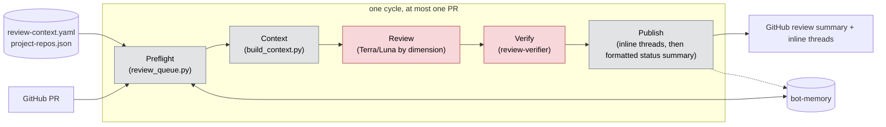
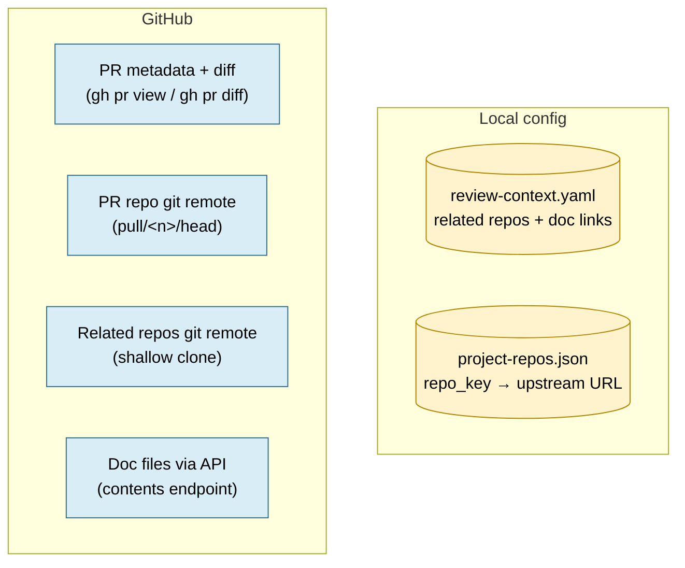
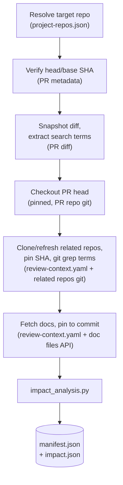
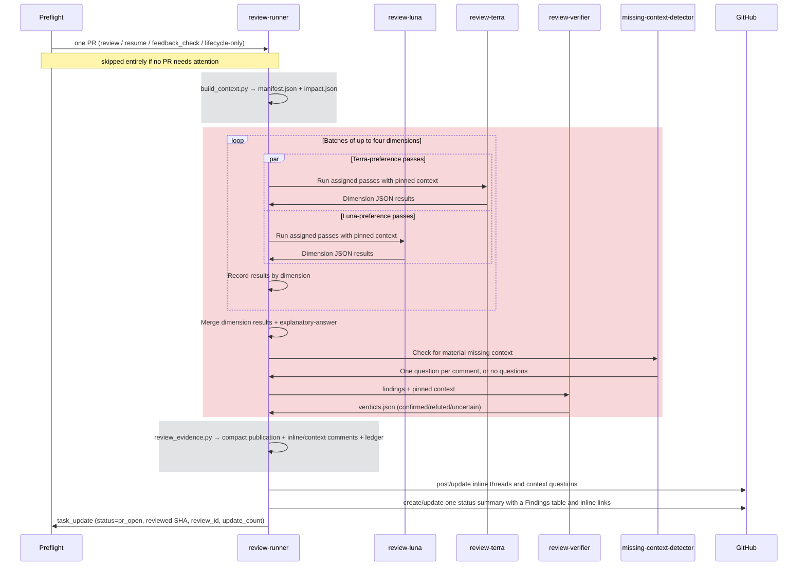
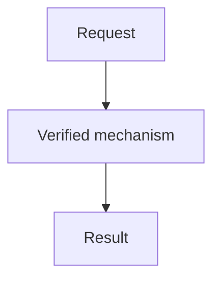

# review-only workflow

`rbac-config-review` is a separate, review-only Rehor bot instance (not yet
deployed). Each cycle it reviews at most one GitHub PR labeled in
`review-context.yaml`, across the repositories in `project-repos.json`. It
never edits, commits, pushes, approves, requests changes, or merges — it keeps
one GitHub review summary per PR and edits it in place each cycle. It also
posts one idempotent inline thread per actionable finding, using the same
finding ID in the summary and inline comment. The summary has a one-sentence
purpose statement followed by a Findings table with plain-text IDs, severity,
dimension, resolution state, and a separate link to each inline thread.
Scenarios, evidence, and fixes stay in the inline comments. The summary ends
with re-review, verification, and explanation commands. Its hidden
versioned ledger payload is restored from GitHub at the start of later cycles,
so review history does not depend on an instance-local file surviving.

Adding the configured review label is the only event that automatically
authorizes a full review. A changed head/base SHA or a `/review-bot re-review`
comment requires an organization member to approve a marked PR comment before
the bot starts a full review. A verified organization member can use
`/review-bot verify` to check prior findings only. Waiting for approval on one
PR does not block other queued PRs.

## Stages



Gray = deterministic script, $0, no model call. Red = an LLM reasons over
pinned context and can be wrong. `C`, `T`, `D`, and `M` spend tokens during a review;
`A`, `B`, and `E` are plain Python. Preflight checks comments before a feedback
cycle so bot-authored updates alone do not start a model session.

| Piece | File | Script or AI | Role |
|---|---|---|---|
| Queue | `preflight/01-review-queue.py` → `review_queue.py` | Script | Picks one newly label-authorized review, approval-gated revision/re-review, feedback pass, or lifecycle reconciliation; checks unseen human comments before a feedback session |
| Config validation | `review_config.py` | Script | Loads and strictly validates `review-context.yaml` (GitHub URL shape, `.md`-only doc links, unique ids) |
| Context builder | `build_context.py` | Script | Checks out the PR head read-only, clones related repos at a pinned SHA, fetches configured Markdown docs at a pinned commit, writes `manifest.json` |
| Skill preparation | `review_skills.py` | Script | Selects dimensions, reads selected recipe YAML at a pinned commit, and generates per-run review skills |
| Impact analysis | `impact_analysis.py` | Script | Deterministically (no LLM) extracts changed identifiers from the diff and `git grep`-matches them in related repos → `impact.json`'s `consumer_usages` (candidates, not confirmed breakage) |
| PR command detection | `rereview_requests.py`, `review_queue.py` | Script | Finds exact re-review and verification commands; the runner verifies each author's organization membership before acting |
| Jira issue creation | `.opencode/agents/jira-ticket-creator.md`, `jira_config.py` | **AI** (subagent) + script | Handles an explicit Jira request or an authorized cross-repo follow-up using the target repository's App Interface profile and an idempotency marker |
| Model routing | `review_skills.py` + `dimensions.yaml` | Script | Resolves each pass's model preference to the configured Terra or Luna subagent in `review_plan` |
| Review criteria | `skills/dimensional-review/SKILL.md` | **AI** (review-terra / review-luna) | Multi-dimension review over pinned context using the configured model profile; results are deduped and consensus-scored |
| Review workers | `.opencode/agents/review-terra.md`, `review-luna.md` | **AI** (subagents) | Read-only workers for dimensions routed to Terra or Luna |
| Context questions and answers | `context_questions.py` | Script | Posts one marked question per comment and finds PR-author answers for the detector to assess |
| Missing-context detector | `.opencode/agents/missing-context-detector.md` | **AI** (subagent) | Asks only material questions, then evaluates author answers against pinned context |
| Explanation quality | `skills/explanatory-answer/SKILL.md` | **AI** (review-runner) | General guidance for direct answers, causal reasoning, evidence, and requested Mermaid diagrams; this workflow maps it to finding fields |
| Verifier | `.opencode/agents/review-verifier.md` | **AI** (subagent) | Independently tries to refute every proposed finding using only pinned sources |
| Evidence gate | `review_evidence.py` | Script | Rejects findings without real pinned locations/references; caps at seven; requires one verdict per finding; renders the status template |
| Review ledger transport | `review_ledger.py`, `review_queue.py`, `post_review.py` | Script | Embeds a public-safe ledger in the status review and restores it from GitHub before a model session |
| Inline publisher | `post_inline_comments.py` | Script | Posts or updates one anchored comment per confirmed finding on the current PR head, deduplicated by finding ID |
| Finding thread resolver | `resolve_review_threads.py` | Script | Resolves only bot-authored finding threads whose addressed state was confirmed by the verifier and published in the status ledger |

Built-in dimensions have `default: true`; the GitHub KISS recipe is
`default: false` and may be selected explicitly. The bot's Python processor
reads its YAML directly and generates a per-run skill; no Goose runtime is
required. The generated skill gets the same pinned PR, related repositories,
docs, and impact report as the built-in passes. Recipe extensions and test
execution are not enabled by importing a recipe. The `high` level includes
the applicable built-in dimensions, including documentation and observability.
Terra is the default model for the primary `review-runner` and for dimensions
without an explicit preference. Each dimension's `model_preference` selects a
read-only worker: Terra uses `review-terra`, and Luna uses `review-luna`.
`review_plan` records the resolved worker. Dimensions run in plan-ordered
batches of at most four concurrent workers; each batch is recorded before the
next starts.
`review-verifier` separately checks findings on Luna. If a preferred worker
fails, that dimension is recorded as failed instead of being silently rerun on
another model.
The high preset remains the default. For a documentation-only diff, dimensions
marked `skip_documentation_only` do not run; the current catalog selects six
passes instead of fourteen. Mixed code and documentation changes still select
the full applicable set, and an explicitly selected skill always runs.
The review-only workflow also uses `--skip-learn`. Its LEARN phase would produce
notes that this instance cannot save to shared memory or include in the
validated PR review; skipping it leaves the finding and verification steps intact.

Each repository can list dimension names in `review-context.yaml` under
`repositories.<repo-key>.skills`. These skills always run for that repository,
including when their catalog entry has `default: false` or the selected level
would exclude them. For example, a repository may explicitly include
`goose-kiss-review`. These names are combined with the default or focused
dimensions without duplicates. Unknown or duplicate skill names are
configuration errors.

Set `format: custom` beside a repository's `skills` to use those skills'
layout for detailed inline comments. Each selected skill must complete and its
actual result is saved. The runner formats each new confirmed finding from a
selected formatting skill using its pinned guide; other findings use the
standard inline layout. The evidence gate enforces the required ID,
severity, dimension, location, trigger, scenario, impact, evidence, and
suggested-fix fields. The status summary stays compact and identical across
formats. An independent verifier checks each skill's inline layout and
attribution before publication.

## The task queue: review_queue.py

Runs every cycle, before any AI session. For every repo in
`project-repos.json`, it lists open PRs carrying `review_label` and classifies
each one — a session only launches if a PR survives all of this. It also
checks tracked tasks missing from the open labeled list for merge, closure, or
legacy-state reconciliation:

1. **Filters out**: drafts, tasks with status `paused` or `archived`, PRs
   authored by the configured bot account except `platex-rehor-bot`, and PRs
   missing a head/base SHA. PRs from `platex-rehor-bot` remain eligible even
   when it is the configured `GH_USER_NAME`. Paused tasks are skipped across
   review, feedback, and lifecycle handling, regardless of SHA changes or new
   comments. An operator must unpause the task before the queue can act on it.
2. **Classifies survivors** into one kind (first match wins):

   | Kind | Condition | Priority |
   |---|---|---|
   | `resume` | Task status is `in_progress`/`pr_changes` and its stored active head/base pair matches the PR | 0 (highest) |
   | `review` | A new event added the configured label, or the current head/base pair differs from the stored review pair and needs approval | 1 |
   | `verify` | A new exact `/review-bot verify` comment from an organization member asks to check existing findings only | 1 |
   | `feedback_check` | SHA unchanged and preflight finds unseen human issue/review feedback; `/review-bot re-review` requests approval for a fresh pass | 2 |
   | `merge_complete` | GitHub confirms a tracked PR has merged | 0 |
   | `closed_unmerged` | GitHub confirms a tracked PR closed without merging | 0 |
   | `reconcile_open` | A legacy `done` task is still open | 3 |

   Jira requests are detected within the ordinary feedback cycle after
   organization membership is verified. A failed creation leaves its request
   comment unseen so a later cycle can retry it. Everything else
   (already reviewed, nothing newer) is excluded. A posted review moves the
   task to `pr_open`; lifecycle-only work marks it `done` only
   after a live GitHub response includes `mergedAt`. Closed, unmerged PRs are
   paused, not done; reopening them does not resume a paused task.
3. **Picks exactly one** candidate across every repo, sorted by
   `(priority, updatedAt, repo, number)` — one PR per cycle, oldest
   highest-priority first.
4. **Authorization and capacity gates**: a new GitHub `labeled` event for the
   configured label authorizes a full review automatically. A currently
   present label without a new label event does not. Head/base changes and
   re-review commands post one idempotent PR comment with a revision-bound
   approval ID. Any member of the repository's GitHub organization can reply
   `Review bot: yes <RA-ID>` or `Review bot: no <RA-ID>`. Only a verified yes
   response authorizes a full pass. Waiting or declining excludes that PR for
   this preflight run and the queue continues to other PRs. A brand-new review
   is skipped if 10 tasks are already active, even if otherwise authorized.
   `/review-bot verify` needs no full-review approval; preflight accepts it only
   from a verified organization member and limits it to the prior ledger.
   An interrupted, already-authorized review resumes without asking again.

Before context building, every model batch, verification, and publication, the
runner re-reads task state. If the task is paused, it stops further review work
and posts nothing; an operator must unpause it before the queue resumes.

Re-review and verification commands are matched exactly from new top-level
comments, bounded by the preflight timestamp, and deduplicated using comment
IDs in task state. `/review-bot re-review` only starts an approval request; it
does not authorize a full review. `/review-bot verify` checks prior findings
only, updates the existing status review without incrementing its review
number, and resolves threads only for findings whose addressed state the
verifier confirms. Both commands require a verified organization member.
Ordinary feedback does not trigger a full review. Before starting a feedback
session, preflight checks issue comments, review comments, and submitted reviews
for unseen human-authored activity. Bot-authored updates alone do not invoke the
model. Same-second feedback IDs are saved to prevent replay.
Requests arriving after a review starts are left for a later cycle. A validated
but unfinished publication is recorded in task state so retries reuse its body
and number rather than counting another review.
When the queue otherwise has no work, it also checks comments at the stored
timestamp boundary: GitHub's second-precision `updatedAt` can be unchanged by
a request made in that same second. This uses GitHub API calls but does not
start an AI session when the PR only has bot comments.

### What identifies a task

Every task has three identity fields, always used together:

- **`external_key`** — `task_key(repo, number)` =
  `review-only:github:<owner>/<repo>#<number>` (e.g.
  `review-only:github:project-kessel/insights-rbac#42`). Built once in
  `review_queue.py` and threaded through every subsequent `task_get`/
  `task_update` call for that PR.
- **`source_type`** — always `"github"` (this instance reviews GitHub PRs
  only; a GitLab MR would need an `"gitlab"` adapter, not built).
- **`instance_id`** — `$BOT_INSTANCE_ID` (e.g. `fabric-access-review`).

All three matter because bot-memory is **shared** across instances —
`rbac-config` (the Jira sprint bot), `rbac-config-konflux`, and this review
instance can all have tasks in the same memory server. `review_queue.py`'s
`load_tasks()` filters strictly on
`source_type == "github" and external_key.startswith("review-only:github:")`
— so even a task for the exact same PR number created by a different
instance is invisible to this one. It includes archived records to keep their
unique keys reserved; a labeled PR with an archived task is skipped until the
existing task is unarchived. There is no author-based or label-based task
filtering; the `external_key` prefix *is* the isolation boundary.

### Memory: task state vs. the shared RAG store

`bot-memory` provides two different things, and this instance treats them
differently. **Task state** (`task_add`/`task_update`/`bot_status_update`)
keeps the SHA pairs, `review_id`, `update_count`, and workflow checkpoints.
The status review comment is the durable findings ledger; a local
`ledger_path` is only a per-cycle working copy restored from that comment.
The **shared RAG learning store**
(`memory_store`/`memory_search`, categories `learning`/`review_feedback`/
`codebase_pattern`, also readable team-wide via the read-only `team-memory`
MCP endpoint) is read-only for this instance — `review-runner.md`'s
permissions deny `bot-memory_memory_store` and `bot-memory_memory_delete`.
It still searches that store for leads (AGENTS.md step 2), it just never
writes a new learning or feedback entry to it; its own history lives in task
state, not shared memory.

## Building context

What `build_context.py` actually does, zooming into the "Context" stage box
above — every fetch is pinned to an exact SHA/commit as it happens:

**Data sources** — everything `build_context.py` reads from outside itself:



**Pipeline** — each step names the source(s) it consumes, in order:



A failed related-repo clone or doc fetch doesn't abort the run — it's
recorded as `{"error": ...}` on that one entry, surfaced later as
`unavailable_sources` rather than silently skipped.

### manifest.json: the trust boundary

The complete, pinned snapshot: the PR's identity and SHAs, the local
checkout path, each related repo's pinned SHA/path/grep matches, each
fetched doc's pinned permalink, and a pointer to `impact.json`.

It exists because the pipeline needs one object that answers "what did we
actually fetch, and at exactly which revision?" — and that object then
doubles as the **authorization list for evidence**. `review_evidence.py`'s
`validate_ref()`/`source_root()` reject any finding whose cited `{repo, sha,
file, line}` isn't something `manifest.json` actually pinned. A finding can't
invent a convenient-sounding reference to a repo or revision nobody fetched —
only what's in the manifest is citable at all.

### impact.json: the cheap cross-repo pre-filter

A deterministic (no LLM), purely textual report: which identifiers changed
in the diff, and which related-repo `git grep` hits also contain one of
those identifiers (`consumer_usages`) — each tagged `"status": "candidate"`,
plus `unavailable_sources` for anything that failed to fetch.

It exists so the AI reviewer doesn't have to manually re-search every
related repo for every changed name on every cycle — that's slow and
expensive to do by hand, in an LLM turn, for each identifier. The script
does that legwork once, cheaply, and hands the `cross-repo-dependencies`
dimension a shortlist of concrete candidates to check instead. It is
explicitly leads, not verdicts: plain string matching can't tell a real
dependency from a coincidental name collision, which is exactly why a
candidate still has to survive the review skill's judgment, review-verifier's
refutation, and `review_evidence.py`'s pinned-reference check before it can
become a published finding.

## One review cycle



Lifecycle-only work skips context generation and review publication. It
rechecks the live PR state, then sets `done` only for a merged PR, `paused` for
a closed unmerged PR, or `pr_open` when reconciling an open PR.

Gray bands are script (no model call); the red band is where Terra or Luna
reviews the selected dimensions and Luna's review-verifier tries to refute
proposed findings.

## Finding shape

The selected review passes are converted into this schema before the
verifier/evidence steps:

```json
{
  "findings": [
    {
      "id": "F1",
      "category": "cross_repo|contract|deploy|invariant|local",
      "source_dimensions": ["correctness"],
      "severity": "blocking|suggestion|nit",
      "location": {"repo": "owner/repo", "file": "path", "line": 1, "side": "added|removed"},
      "claim": "...",
      "trigger": "specific input or code path",
      "impact": "...",
      "scenario": ["step 1", "step 2"],
      "evidence": {
        "explanation": "... [R1].",
        "refs": [{"id": "R1", "repo": "owner/repo", "sha": "40-character pinned SHA", "file": "path", "line": 1}]
      },
      "suggested_fix": "..."
    }
  ]
}
```

A `cross_repo` finding must cite a concrete related-repository reference —
normally a `consumer_usages` entry from `impact.json` — never the
`review-context.yaml` relationship declaration alone.

## Ledger: one review, updated over time

The first cycle writes an initial `ledger.json` with every confirmed finding
marked open. Before the status review is posted, the publisher embeds a
versioned, compressed ledger payload in an HTML comment in that same review
body. The GitHub status review is the durable source; preflight restores a
temporary working copy at the start of each later cycle. Its IDs are carried
forward unchanged.

From a task's second cycle onward, `review_evidence.py` also takes a prior
`ledger.json` (every finding ever confirmed for this task, each `open` or
`addressed`) restored from the status review, and a proposed re-check of each
`open` entry:

```json
{"verifications": [
  {"finding_id": "F1", "status": "addressed|still_open|uncertain",
   "explanation": "...",
   "refs": [{"repo": "owner/repo", "sha": "...", "file": "path", "line": 1}]}
]}
```

`refs` is required only for `"addressed"` — review-verifier must also confirm
those (same adversarial check as new findings) before the ledger entry closes.
`"still_open"`/`"uncertain"` need no verdict. One re-check per currently-open
entry is required; the merged result becomes the new `ledger.json`. The posted
review body has a `Review N` heading, a one-sentence description of what the PR
changes, and a Findings table with each finding's stable ID, severity,
dimension, resolution state, and inline-thread link. Detailed explanations
stay in the inline comments. Review numbers omit the `#` prefix so GitHub does
not treat them as issue links.

The hidden payload is not private data: GitHub returns HTML-comment text in
the review body API to anyone who can access the PR. It stores only the fields
needed to resume the review. Open findings contain the same claim, scenario,
impact, suggested fix, and pinned references already shown in their inline
comments, with raw source-line text removed. Addressed findings are reduced to
ID/status tombstones so IDs are never reused. Verifier notes and other
unpublished analysis are not included. Never include credentials, secrets, or
private instructions. Before posting, status, inline, and context-comment
publishers reject recognized credential patterns and some common personal or
payment identifiers without echoing their values. This guard covers common
token/key formats, credential assignments, email addresses, SSNs, and
payment-card numbers; it is not a general secret or personal-data detector,
so review text must still avoid sensitive details. At preflight, the tracked
GitHub status review is checked first. If it has no ledger payload, preflight
checks a matching saved publication and the legacy local ledger. If none can
be restored, it posts one PR comment with a stable recovery ID. Any member of
the repository's GitHub organization can approve or decline by including
`Review bot: yes <recovery-id>` or `Review bot: no <recovery-id>` anywhere in
their comment. Preflight verifies membership using the bot's GitHub
credentials. A response that has not arrived, or whose membership cannot be
verified, leaves that PR waiting. Preflight then continues scanning for the
next eligible task, so that wait does not block other PRs or start an AI
session for the waiting PR. An approved fresh review starts at update count 0
and cannot preserve the old finding IDs. An empty bot-owned pending review
for the current head with no review comments can be reused after approval. If
the empty draft targets an older head, omit its tracked review ID and publish
a new status review. Pending reviews with content or inline comments still
require manual reconciliation.

## Explaining a review finding

The general `explanatory-answer` skill supplies the writing approach. This
workflow's finding schema maps a direct answer to `claim`, the circumstance to
`trigger`, the why and reasoning to `evidence.explanation` with pinned
`evidence.refs`, the consequence to `impact`, and the correction to
`suggested_fix`. Re-check explanations use the same causal chain. PR findings
use prose because the summary is compact and inline threads have limited width.
During a feedback check, a verified member can ask how or why a finding occurs.
The bot answers from pinned context in the same inline thread or as a top-level
reply, using `explanatory-answer`; the reply carries a hidden
`dev-review-bot:fabric-access-explanation:<source-comment-id>` marker and does
not start a new review.

For longer replies, use this structure and omit optional sections when they
add no value. A simple answer may need only the first line:

````markdown
**Answer:** <direct response>
**Why or how:** <mechanism in a clear sequence>
**Reasoning:** <pinned facts and evidence supporting the answer>
**Example:** <only when useful>
**Implication:** <what follows or what to do, when relevant>



<!-- dev-review-bot:fabric-access-explanation:<source-comment-id> -->
````

Include the Mermaid block when a commenter explicitly asks for a diagram and
the pinned facts support one. Without an explicit request, include it only
when it materially improves understanding. Keep it out of status summaries
and original finding comments.

For example, [PR #3567](https://github.com/project-kessel/insights-rbac/pull/3567#discussion_r4511659742)
has a documentation mismatch:

- **What:** The example calls the replacement field `v2_alternative` and puts
  human-readable guidance in `error`.
- **When:** A client handles a blocked `create_role_v1` result using that example.
- **Why:** The handler returns a machine code in `error`, guidance in `message`,
  and the replacement in `use_instead`. For `list_access` it returns
  `allowed_applications`, which the docs call `v2_excluded_applications`.
- **Reasoning:** Looking up `v2_alternative` finds no value; displaying
  `error` shows only the machine code. The documented path therefore cannot
  reliably choose or explain the replacement.
- **Impact:** A client following the example may omit the V2 tool guidance.
- **Fix:** Align the documented fields with the emitted response.

## Example comments

Status review template (the publisher replaces `review-comment:F1` with the
GitHub URL of the inline thread; finding IDs remain plain text):

```markdown
## Review 2

This PR aligns the documented role response with the fields returned by the handler.

### Findings (2 total; 1 open, 1 addressed)

| ID | Severity | Dimension | Status | Inline comment |
|---|---|---|---|---|
| F1 | blocking | correctness | open | [Open thread](review-comment:F1) |
| F2 | nit | documentation | addressed | [Open thread](review-comment:F2) |

---

- **Re-review:** Add a new top-level PR comment containing `/review-bot re-review`; the bot will ask for approval before reviewing.
- **Verify findings:** Add a new top-level PR comment containing `/review-bot verify`; the bot checks existing findings only.
- **Explanation:** Ask a question about a finding in a PR comment; the bot will answer with pinned context.

<!-- dev-review-bot:fabric-access-review:<head_sha>:<base_sha> -->
<!-- dev-review-bot:review-ledger:v1:<compressed-public-ledger> -->
```

The ledger line is hidden in the rendered comment but remains readable via the
GitHub API. It is a transport for public review state, not an access-control
boundary.

The linked inline comment carries the evidence needed to act:

```markdown
**[F1]** The response field name does not match the handler.

**Severity:** blocking

**Dimension:** api-contract

**Location:** `api/response.py:42`

**Trigger:** A client reads the replacement field after the handler rejects a V1 request.

**Scenario:**
1. Send a V1 request to the changed handler.
2. Read the replacement field from the response using the documented name.

**Impact:** The client cannot select the supported V2 operation.

**Evidence:** The handler emits `use_instead` at [api/response.py:42](https://github.com/org/repo/blob/<sha>/api/response.py#L42), while the linked documentation names another field at [docs/api.md:12](https://github.com/org/repo/blob/<sha>/docs/api.md#L12).

**Suggested fix:** Document the field emitted by the handler.

<!-- dev-review-bot:fabric-access-finding:F1 -->
```

A context question is a separate top-level comment with one direct question,
severity `question`, dimension `missing-context-detector`, a realistic scenario,
and pinned evidence. It does not appear in the finding count.

The summary and inline thread are the PR review comments (GitHub). Separately,
`bot_status_update`
("Use bot_status_update with this instance ID at cycle start and end",
AGENTS.md) drives the dashboard banner, not a PR comment — `state`
(`working`/`idle`/`error`), `message`, `external_key?`, `repo?`,
`instance_id?`:

```
bot_status_update(instance_id="fabric-access-review", state="working",
  message="Reviewing PR #42", external_key="review-only:github:project-kessel/insights-rbac#42",
  repo="insights-rbac")
...
bot_status_update(instance_id="fabric-access-review", state="idle",
  message="Posted Review 3")
```

or, when preflight found nothing to do that cycle:

```
bot_status_update(instance_id="fabric-access-review", state="idle",
  message="No PR needs review")
```

## Guardrails

- **review-runner** permissions deny `edit`, all subagents except
  `missing-context-detector`, `review-terra`, `review-luna`, and
  `review-verifier`, `webfetch`, `websearch`, and the shell patterns
  `git push*`, `git commit*`, `gh pr merge*`, `gh pr edit*`, `gh pr
  review*--approve*`.
- **missing-context-detector** permissions deny `edit`, `shell`, all subagents,
  `webfetch`, and `websearch`; it evaluates context and answers against pinned
  sources.
- **review-terra** permissions deny `edit`, `shell`, all subagents,
  `webfetch`, and `websearch`; it reviews only the supplied dimension guide and
  pinned sources.
- **review-verifier** permissions deny `edit`, `shell`, all subagents,
  `webfetch`, and `websearch` — it can only reason over the context it's
  given.
- Idempotency: a task's `review_id` (once set) means every later cycle edits
  that same review via `PUT .../reviews/<review_id>` instead of posting a new
  one — there is at most one review summary per PR. The inline publisher
  upserts comments by finding ID for the current head, so retries do not
  duplicate a thread. Summary headings use `Review N` (without `#N`), followed
  by a short PR-purpose sentence and a Findings table. Finding IDs stay plain
  text; each row has a separate inline-comment link. Inline
  comments start with the same ID; custom formats preserve their selected
  skill's detailed layout. GitHub may create separate review records for inline
  comments; the tracked `review_id` remains the summary review's ID. A
  `<!-- dev-review-bot:fabric-access-review:<head_sha>:<base_sha> -->`
  marker in the summary records which revision it reflects. `feedback_check`
  cycles do not touch `review_id` or inline threads unless a fresh label-add
  event or an approved re-review starts the normal review path. Verified member feedback is
  recorded in task state; this instance cannot write to shared memory.
- Related repositories and linked docs are read-only context — they never
  expand the PR queue, and `review-context.yaml` is the only source of
  cross-repo relationships (no inferring or fetching unlisted repos).

## Related

- `AGENTS.md` (this workflow) — full step-by-step instructions
- `skills/dimensional-review/SKILL.md` (`../../skills/dimensional-review/SKILL.md`) — dimension catalog and the `rbac-config-review`-specific dispatch/output overrides
- `skills/explanatory-answer/SKILL.md` (`../../skills/explanatory-answer/SKILL.md`) — general explanation guidance mapped to findings by this workflow
- `../../review-context.yaml` — declared repo relationships and doc links
- `../../../../../dev-bot/docs/presets/custom-preflight.md` — the `start`/`skip`/`error` preflight contract `01-review-queue.py` implements
